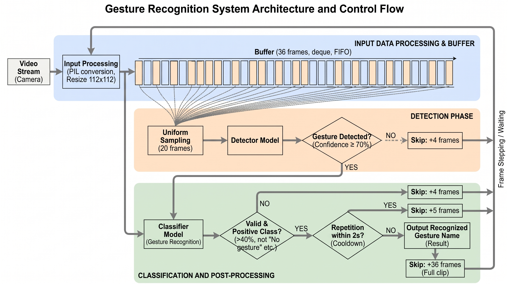

# Gesture Recognizer

**Real-time dynamic hand gesture recognition from a plain RGB camera, built on a hybrid 3D-CNN + Transformer architecture.**

Developed as a BSc thesis project (*Controlling a Quadruped Robot with Dynamic Gestures*) at the Faculty of Information Technology and Bionics, Pázmány Péter Catholic University, 2025. The system was deployed on a Boston Dynamics Spot robot at HUN-REN SZTAKI (integrated into a containerized ROS2 environment) to control it with natural hand movements instead of a remote console.

- **Real-time**: runs on a live webcam stream, with a lightweight detector gating the heavier classifier
- **Spatio-temporal**: ResNet-18 backbone extended with 3D convolutions, followed by a Transformer encoder
- **27 gesture classes**, trained on the Jester dataset
- **95.07 %** accuracy on a Jester subset where the HaGRID Dynamic Gestures baseline reaches 20.56 % and the pure 2D CNN + Transformer baseline 85.43 %

> **Author:** Vajna Levente · **Supervisor:** Dr. Kovács Lóránt · **Consultant:** Dr. Benedek Csaba

---

## Repository structure

```
├── README.md
├── checkpoints/       # trained model weights (download separately)
├── condaenv.yml       # conda environment definition
├── dataset/           # Jester dataset loader and data utilities
├── detector/          # lightweight binary gesture detector
├── media/             # figures and demo video
├── models/            # gesture classifier architectures (v1–v4)
├── recognizer.py      # real-time recognition demo (webcam)
├── test.py            # model evaluation
└── train.py           # training script
```

## Overview

### Pipeline



1. **Input**: frames from the camera are resized to 112 × 112 and pushed into a 36-frame FIFO buffer (`collections.deque`).
2. **Detector**: 20 evenly sampled frames from the buffer are passed to a small network that decides whether a gesture is present (confidence ≥ 70 %).
3. **Classifier**: only if a gesture is detected, the full 36-frame clip is classified.
4. **Post-filtering**: "No gesture" / "Doing other things" and predictions below 40 % confidence are rejected; the same gesture cannot fire twice within 2 s. A skip counter avoids unnecessary computation on idle frames.

### Model

| | Classifier (v4) | Detector |
|---|---|---|
| Backbone | ResNet-18 (2D) + 3D residual block (256 → 512 ch.) | ResNet-18 (2D) + 3D residual block (128 → 256 ch.) |
| Temporal model | Transformer encoder, 6 layers, 8 heads, d = 512 | Transformer encoder, 2 layers, 4 heads, d = 256 |
| Input | 36 frames, 112 × 112 RGB | 20 frames, 112 × 112 RGB |
| Output | 27 gesture classes | gesture / no gesture |
| Parameters | 46.6 M | 9.5 M |

The 3D convolution block placed on top of the 2D backbone captures short-term motion, while the Transformer encoder models long-range temporal dependencies across the clip.

### Dataset

Trained on **[Jester](https://www.qualcomm.com/developer/software/jester-dataset)**: 148,092 short video clips of 27 hand gesture classes (incl. *No gesture* and *Doing other things*), recorded from 1,300+ people with ordinary webcams; split 80 / 10 / 10 into train / validation / test.

Training setup: Adam (lr 0.002, cosine annealing), class-weighted cross-entropy, batch size 32, up to 50 epochs with early stopping, colour/rotation augmentation, checkpoint averaging.

### Robot control (thesis integration)

Recognized gestures were published as ROS2 messages and mapped to Spot commands: vertical hand movement → stand / sit, two-finger vertical movement → extend / stow the arm, horizontal swipes → turn right / left.

## Getting started

**Requirements:** [Conda](https://docs.conda.io/en/latest/miniconda.html), Python 3, a webcam (a CUDA GPU is recommended).

```bash
# 1. Clone the repository
git clone https://github.com/vlevente24/GestureRecognition
cd GestureRecognition

# 2. Create and activate the environment
conda env create -f condaenv.yml
conda activate gestrec

# 3. Download the trained weights into ./checkpoints  (link below)

# 4. Run the real-time recognizer
python recognizer.py
```

**Weights download:** [Google Drive link](https://drive.google.com/drive/folders/1e45Z3x3BK1imT4kJieCpLbxyi0Zp67mV?usp=sharing)

### Training your own model (optional)

Everything needed to retrain is included: download Jester into `dataset/`, then use `train.py` to train and `test.py` to evaluate. Training supports checkpoint resuming. Opcionally new model structures can be created too.

## Results

### Model variants (ablation)

| Version | Architecture | Accuracy | Parameters |
|---|---|---|---|
| v1 | ResNet-18 + 3D conv + Transformer | 92.07 % | 37.2 M |
| v2 | ResNet-18 + Transformer *(2D only)* | 82.27 % | 30.1 M |
| v3 | 3D ResNet-18 + Transformer | 91.60 % | 52.1 M |
| **v4** | **ResNet-18 (+ 3D block) + Transformer** | **94.50 %** | 46.6 M |
| Detector | ResNet-18 (+ 3D block) + small Transformer | 98.01 % (binary) | 9.5 M |

<sub>v1–v3 evaluated on the test set, v4 and the detector on the validation set.</sub>

Removing the 3D convolution (v2) costs ~10 percentage points, confirming that explicit spatio-temporal feature extraction is essential.

### Comparison with other methods

Evaluated on the subset of Jester classes shared with HaGRID, so that all methods are tested on the same data.

| Method | Architecture | Accuracy |
|---|---|---|
| HaGRID Dynamic Gestures | hand detector + static classifier | 20.56 % |
| Transformer-Based Network (D'Eusanio et al., 3DV 2020) | ResNet-18 + Transformer | 85.43 % |
| **This work (v4)** | **ResNet-18 + 3D block + Transformer** | **95.07 %** |

### Real-world test on the Spot robot

| | HaGRID Dynamic Gestures | This work |
|---|---|---|
| Recognition reliability | often needs several attempts | high, first try |
| Gesture style | slow, deliberate movements required | natural, fast or slow |
| Effective range | up to ~3 m | ~1–2 m |

The shorter range comes from Jester itself (subjects sitting ≤ 1.5 m from the camera). Adaptive cropping/zoom and multi-scale architectures are the planned next steps.

## Demo

<video src="media/gesture_recognizer_realtime.mp4" controls width="720"></video>

If the video does not play in your viewer, [watch the demo here](https://drive.google.com/file/d/13sKoaZNTwfTCPn9AmiQDr5dL-hLUUzd6/view?usp=sharing).

## References

- Materzynska et al., *The Jester Dataset: A Large-Scale Video Dataset of Human Gestures*, ICCV Workshops 2019
- D'Eusanio et al., *A Transformer-Based Network for Dynamic Hand Gesture Recognition*, 3DV 2020
- Nuzhdin et al., *HaGRIDv2: 1M Images for Static and Dynamic Hand Gesture Recognition*, 2024
- Vaswani et al., *Attention Is All You Need*, NeurIPS 2017
